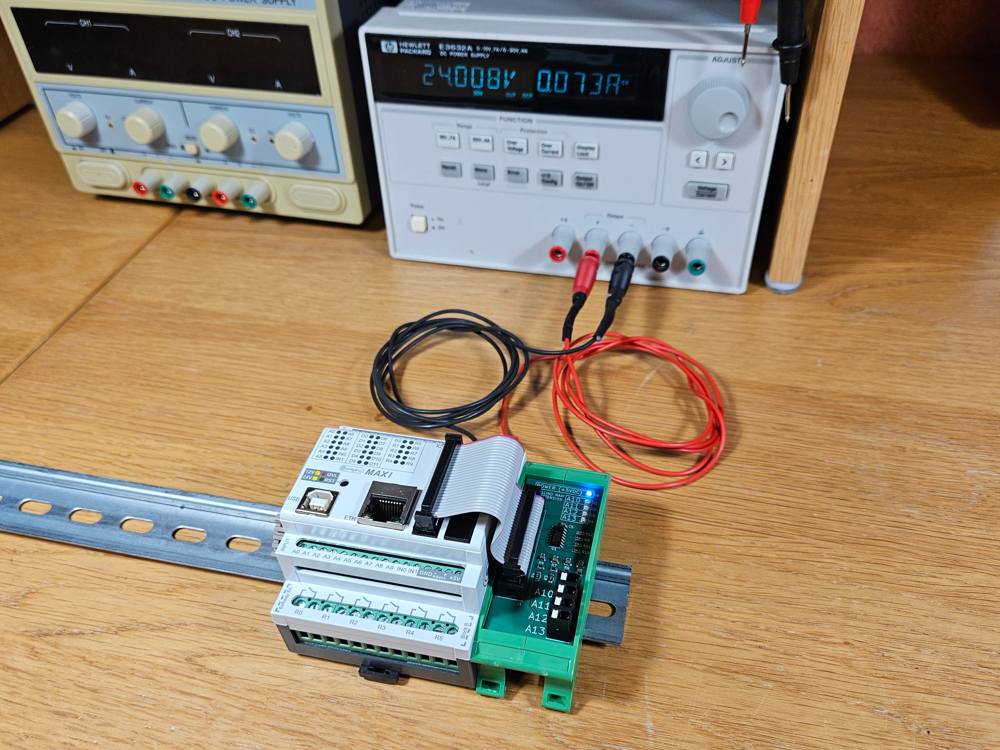
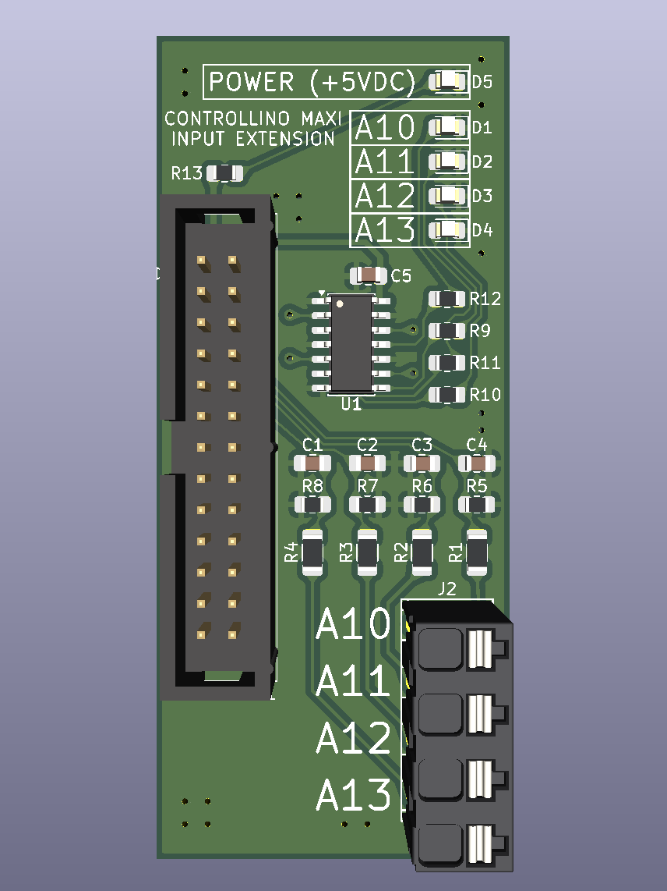
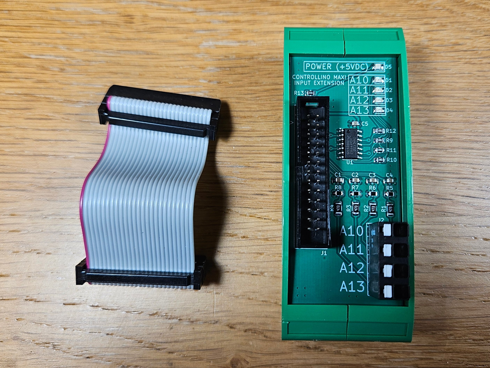
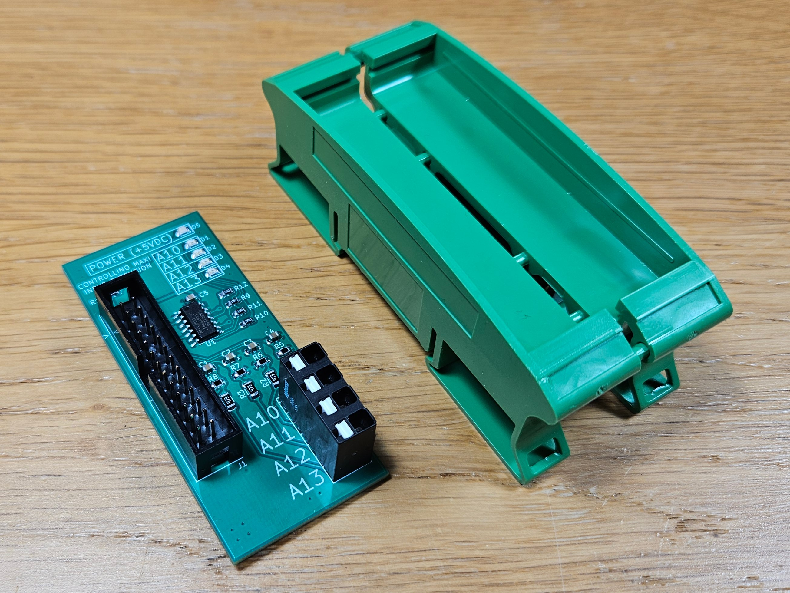
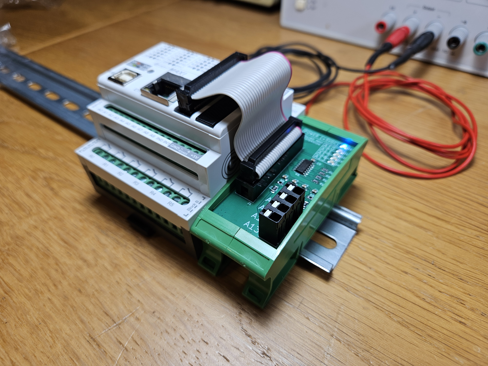

# Controllino MAXI Input Extension

A small DIN-rail mounted add-on board that adds **four 24 V inputs** to a
[CONTROLLINO MAXI](https://www.controllino.com/) PLC. The board plugs into the PLC's
**X2 pin header** with a 26-pin ribbon cable. It scales 24 V field signals down to
the 0–5 V range of the analog inputs **A10–A13** on that header, and has an indicator
LED for each channel.

  

## Features

- 4 input channels (A10, A11, A12, A13) for 24 V DC signals
- Resistor divider (47 kΩ / 10 kΩ) scales 24 V to about 4.2 V for the PLC's ADC
- 100 nF RC low-pass filter on each channel to reduce noise
- Green status LED per channel, driven by a 74LS125 buffer so the LEDs do not load the measured signal
- Blue LED for Controllino +5 V power supply
- Powered from the PLC: +5 V and GND come over the ribbon cable, so no external supply is needed
- WAGO push-in terminal block for field wiring
- Fits an [Italtronic XT72](https://eng.italtronic.com/products/support_xt_en/xt_72_support_xt_en/) DIN-rail PCB holder (board size 31.05 × 72.15 mm)

## Photos

| PCB render | Assembled board and ribbon cable |
|---|---|
|  |  |

| Board and DIN-rail holder | Connected to the PLC |
|---|---|
|  |  |

## How it works

1. **Voltage divider.** A 47 kΩ / 10 kΩ divider scales the input by 10 / 57 ≈ 0.175.
2. **Filter.** A 100 nF capacitor across the 10 kΩ resistor forms a low-pass filter
   with a cut-off frequency of about 190 Hz (source impedance 47 k ∥ 10 k ≈ 8.2 kΩ).
3. **To the PLC.** The divided voltage goes straight to the matching analog pin on the
   ribbon cable, where the PLC reads it.
4. **Indicator.** The same signal also feeds one gate of a 74LS125 quad buffer, whose
   output drives the channel's LED through a 1 kΩ resistor. The output-enable pins
   are tied to GND, so all four buffers are always on.

### Signal levels (ideal divider)

| Input voltage | Voltage at PLC pin | 10-bit ADC reading (5 V ref) |
|---:|---:|---:|
| 0 V | 0 V | 0 |
| 17.1 V | 3.00 V | ~614 |
| 24 V | 4.21 V | ~862 |
| 28.5 V | 5.00 V | 1023 (full scale) |

Comment: Minimum Voltage for ATMEGA2560 (Controllino Maxi CPU) input to be considered High is 0.6×VCC (see ATMEGA2560 datasheet). 0.6×5.0 V(VCC) = 3.0 VDC

Input current at 24 V is ~0.42 mA per channel.

> **Note:** These figures assume an ideal divider. The 74LS125 input current loads
> the divider slightly, so check the actual readings on your hardware and set your
> software thresholds from those. Keep the inputs below about 28 V so the PLC pin
> stays within its 5 V range.

## Bill of materials

Recommended component manufacturer and part numbers are attached to schematic symbol properties. See image of symbol properties table below:

